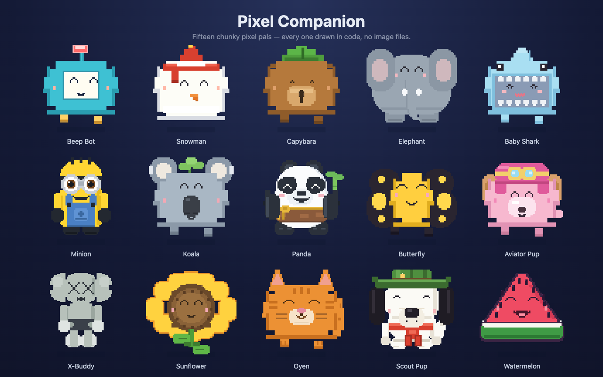
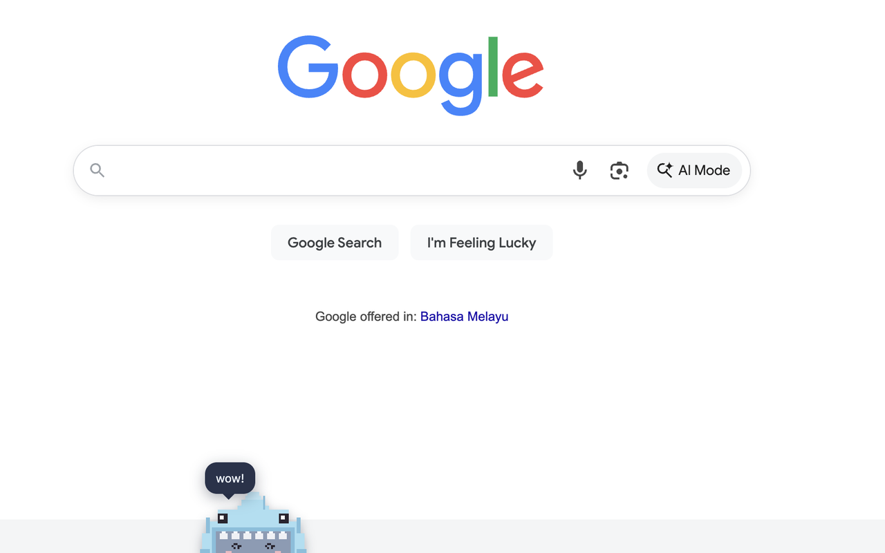
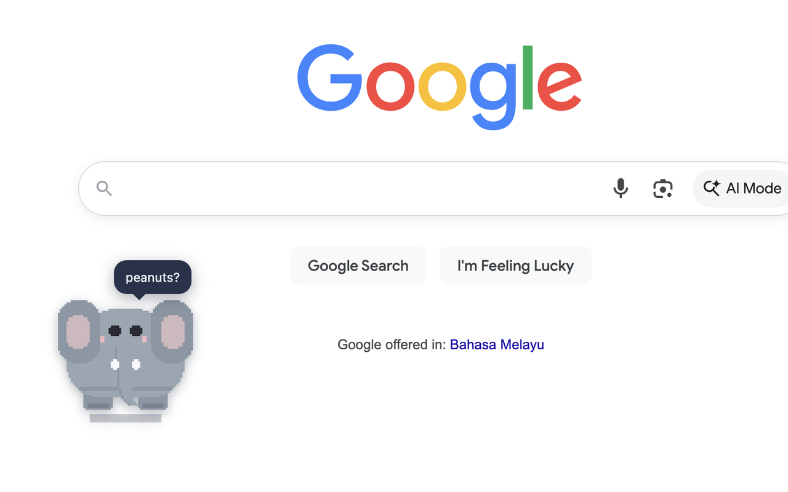

# Pixel Companion

A tiny chunky pixel pal that lives at the bottom of every web page. It walks,
idles, squashes when you poke it, turns to face your cursor and waves when you
hover, rides the scrollbar, drags and pins, and talks in little speech bubbles —
with **fifteen characters** to choose from.



## Characters

| | | |
|---|---|---|
| **Beep Bot** | **Snowman** | **Capybara** |
| **Elephant** | **Baby Shark** | **Minion** |
| **Koala** | **Panda** | **Butterfly** |
| **Aviator Pup** | **X-Buddy** | **Sunflower** |
| **Oyen** | **Scout Pup** | **Watermelon** |

<p align="center">
  
  
</p>

Each is drawn entirely in code (no image assets) and has its own speech
personality — the koala naps, the panda practices kung fu, the capybara is
unbothered, X-Buddy just says "xx", Scout Pup salutes at everything, and Oyen
the ginger cat is permanently unimpressed.

## Install

**From the Chrome Web Store (recommended once live):**

> Install: [Chrome Web Store — _link goes live after review_]

**From source (developer install):**

1. Clone or download this repo
2. Open **chrome://extensions** in Chrome
3. Enable **Developer mode** (top-right)
4. Click **Load unpacked** and select the `pixel-companion-extension/` folder

The companion runs on `http`/`https` pages only. `file://` pages are not
supported, so the "Allow access to file URLs" toggle on the extension's Details
page has no effect.

## Features

- Walks along the bottom of the viewport, flips at edges
- Idles, blinks, sits, and drops speech bubbles
- Squashes and boings when you click or tap it
- Turns to face your cursor when it comes near; waves when you hover over it
- Rides the scrollbar on long pages
- Four of them break into their own routine: the panda's kung fu, Oyen's big
  stretch, Scout Pup's salute and the watermelon's seed spit
- The watermelon has no arms and no legs — it hovers above the floor and
  bounces along instead of walking
- Press and hold to grab & drag; drop away from the floor to pin it mid-air
- All sound effects are synthesized with the Web Audio API — no audio files

### Popup settings

- Character picker with live previews, plus a 🎲 **Surprise me** shuffle that
  rolls across the roster and lands on a random pal
- Per-site on/off + global master toggle
- Size 2–10 px, speed 0.4×–3×
- Separate sound / speech toggles
- Light / dark / follow-system appearance — the popup and the speech bubbles
  both follow it

Settings save to `chrome.storage.local` and apply live in every tab.

## Privacy

No data collection. No analytics, no accounts, no tracking, no servers.
Works 100% offline after install. Permissions are limited to:

- **storage** — saves your settings on your own device
- **activeTab** — lets the per-site toggle know the current site

Content scripts never run on `chrome://` pages or the Chrome Web Store.

## Support

Found a bug or have a character idea? [Open an issue](https://github.com/Limpohal/pixel-companion-extension/issues).

## Development

```
node test/render-headless.js       # renders all skins, guards renderer drift
node test/interaction-headless.js  # pointer layer: hit testing, drag, pin
node test/boot-headless.js         # settings/boot: a disabled pal stays idle
node test/cws-audit.js             # pre-submission audit: manifest, zip, safety, docs
node --expose-gc test/stress-headless.js  # 60k-frame leak/stress + cost benchmarks
node tools/ascii_preview.js        # render skins as ASCII in a terminal
python3 tools/gen_icons.py         # regenerate extension icons
python3 tools/gen_cws_assets.py    # regenerate the 128px store icon
# store art (roster/promo/marquee): open tools/store-art.html?shot=roster
```

## License

MIT
